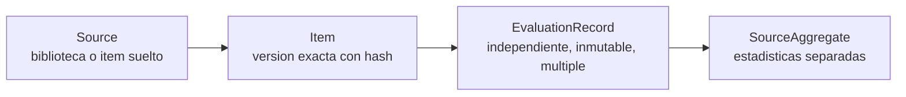

# ICAP

Instrumento de evaluación de calidad pictográfica para comunicación aumentativa y alternativa. Iniciativa de la red MediaFranca.

Regla conceptual del sistema: **PICTOS.net publica bibliotecas; ICAP produce registros de evidencia sobre versiones exactas de sus pictogramas.**

## Fuente de verdad

`spec/icap.allium` es la especificación formal del comportamiento. Ante cualquier duda sobre qué debe hacer el sistema, esa es la respuesta, no este archivo ni el código existente. Está escrita en Allium v3.

El CLI de Allium no está instalado en todos los entornos. Cuando esté disponible, validar con `allium check spec/icap.allium` antes de dar por buena una modificación de la spec.

Documentación de apoyo en `docs/`:

- `ICAP_v2_especificacion.md`, especificación conceptual original
- `ICAP_v2_dimensiones.md`, las 14 dimensiones con paradigmas y referencias
- `ICAP_v2_arquitectura_datos.md`, los cuatro objetos y por qué
- `ICAP_v2_respuesta_evaluacion.md`, respuesta a la evaluación psicométrica externa
- `ICAP_v2_front_requisitos.md`, pantallas y patrones de interacción
- `ICAP_v2_plan_implementacion.md`, fases de construcción

## Ramas

- `main`, versión 1 publicada en GitHub Pages. No tocar sin decisión explícita.
- `v1-archive`, congelado de v1. Inmutable.
- `v2`, frente de trabajo. Reemplazará a `main` cuando esté estable.

## Arquitectura

Cuatro objetos desacoplados. La evaluación no es una propiedad del pictograma.

Catorce dimensiones en cuatro capas, separadas por **origen del dato**, no por objeto de medición:

- Capa A, geométrica: A1 grosor, A2 unidades desligadas, A3 regiones cerradas, A4 contorno inferido. Automática.
- Capa B, psicofísica: B1 desenfoque, B2 tamaño, B3 desplazamiento. Humana, sobre submuestra del 20 por ciento.
- Capa C, interpretativa: C1 semántica, C2 pragmática, C3 cultural, C4 aprendibilidad. Humana, Likert 1 a 5.
- Capa D, familia: D1 confusabilidad, D2 consistencia, D3 fragilidad. Automática.

Veredicto en dos niveles. Vetos duros, que son condiciones necesarias no compensables: A1 y D1 pertenecen a la versión del ítem porque son deterministas, B2 pertenece al registro porque depende del contexto de presentación declarado. Todo lo demás es perfil compensatorio que se reporta pero no elimina.

## Decisiones no negociables

Estas se violaron en v1 o se propusieron y se rechazaron con argumento. Romperlas convierte al instrumento en otra cosa.

1. **Nunca un puntaje único.** No promediar entre capas: sus unidades no son conmensurables. No reconstruir el promedio de v1 por ninguna vía.
2. **Nunca un radar de más de tres ejes.** El hexágono de v1 desapareció por eso. La capa C admite triángulo porque sus tres ejes sí son comparables.
3. **Los vetos son pisos físicos, no predictores estadísticos.** Su justificación no depende de ninguna correlación local, y por eso sobreviven a la recalibración del corpus.
4. **Todo bloqueo muestra su causa.** Nunca un rojo agregado sin veto nombrado.
5. **La ausencia de dato es un dato.** Cuatro estados por dimensión: puntuado, no aplicable, sin competencia para juzgar, omitido. Sin valor por defecto. Forzar un 3 contamina más que aceptar la ausencia.
6. **Nada se corrige en silencio.** El informe de validación de ingesta es bloqueante y descargable, y nombra toda exclusión.
7. **Rúbrica, protocolo y conjunto de calibración viajan en el registro**, no en la aplicación. Un registro sin las tres versiones no es comparable con ningún otro.
8. **Los registros sellados son inmutables.** Ninguna regla de escritura admite `sealed` en su precondición.
9. **La revelación diferida es estructural.** Ni la frase objetivo durante la comprensión espontánea, ni el ancla durante la calibración, pueden llegar al cliente. Ocultarlas con CSS no cumple la garantía.
10. **A3 y A4 son advertencia e hipótesis**, nunca puntajes validados. La distinción debe ser visible en la interfaz.
11. **La divergencia de calibración nunca bloquea.** Los vetos son sobre el signo, no sobre quien juzga.
12. **No automatizar C1 a C4.** Requieren juicio humano y competencia cultural.

## Estado de la evidencia

Toda cifra empírica local está en suspenso. El análisis de referencia corrió sobre 13 pictogramas cuando el corpus es de 21, de modo que correlaciones, intervalos, tasas de cumplimiento y umbrales deben recomputarse antes de tratarse como evidencia. Los valores del bloque `config` de la spec son marcadores de posición heredados de las anclas verbales de la rúbrica de v1, no constantes calibradas.

La arquitectura no depende de esos datos, depende de literatura externa citable. Esa asimetría ya se puso a prueba: al caerse las cifras locales, las decisiones sostenidas en literatura siguieron en pie y las que se apoyaban en el corpus propio quedaron aplazadas.

## Front-end

Stack decidido: framework con build. Locale inicial `es-419`, i18n desde el primer commit. Nota de despliegue: `main` hoy publica el directorio raíz tal cual en GitHub Pages, de modo que introducir un paso de build exige ajustar la publicación.

Acceso al sitio: abierto, con perfil etnográfico del evaluador, consentimiento versionado y calibración previa bloqueante.

Marca principal: **ICAP**, sola, en Lexend 800 versalita. Sigla resuelta como *Índice de Calidad Pictográfica*.

Las surfaces de `spec/icap.allium` mapean casi uno a uno a tipos de pantalla, y sus garantías son requisitos de interfaz, no recomendaciones.

### Lectura obligatoria antes de tocar UI

En este orden; no se puede saltar:

1. `docs/GUARANTEES_UI.md` — las 13 garantías traducidas a exigencias de DOM. Romper una rompe el instrumento. Tres de ellas exigen que un dato no llegue al cliente: ocultarlo con CSS deja la garantía decorativa.
2. `docs/VISUAL_LANGUAGE.md` — el vocabulario visual y su razón de ser.
3. `docs/UI_CONVENTIONS.md` — cómo se escribe. Es **ley** y no se sobreescribe por instrucciones de chat.
4. `docs/UI_MAP.md` — mapa de IDs semánticos de las 17 pantallas. Actualizarlo en el mismo commit que crea o renombra una región.
5. `docs/lenguaje-visual.html` — hoja de especímenes. Abrirla en el navegador: forma canónica de cada componente con su ID. Cuando un documento y la hoja difieran, manda la hoja.

### Reglas que se rompen sin darse cuenta

- **Ningún puntaje único.** No hay promedio de capas, no hay hexágono de seis ejes, no hay semáforo agregado.
- **La frase objetivo no está en el DOM** de la vista de comprensión espontánea. Tampoco el ancla en calibración mientras se puntúa. El endpoint no entrega esos campos.
- **Tras sellar, el control de edición se retira**, no se deshabilita.
- **Los tres estados de ausencia de la capa C tienen el mismo peso gráfico que la escala 1–5**, en la misma fila. Ninguna dimensión arranca con valor.
- **El control de umbrales nunca muestra su valor numérico**, ni en pantalla, ni en tooltip, ni en `aria-valuetext`.
- **`pendiente` y `no muestreado` no pueden verse iguales.** La segunda no tiene tarea asociada y nunca la tendrá.
- **Los tres umbrales de veto son propuestas sin calibrar** y la interfaz lo dice en el punto de edición, no en la documentación.
- **Ningún valor literal** de color, spacing, radio o z-index en un componente: todo sale de `styles/variables.css`. Ningún texto literal fuera de `locales/`.

### Convenciones de marcado propias

Además de los `id` semánticos de `docs/UI_MAP.md`:

- `data-screen-label` en la raíz de cada pantalla.
- `data-icap-layer="A|B|C|D"` en cada bloque de capa.
- `data-icap-dim="A1…D3"` en cada elemento que presente una dimensión.
- `data-icap-state="pendiente|no-muestreado|registrada|superada|calculando|excluida"` en cada elemento que presente un estado de dato.

### Tipografía

- `font-sans` = Lexend — todo lo que una persona dice o lee.
- `font-mono` = Fira Code — IDs, hashes, versiones, valores numéricos medidos, nombres de dimensión. Nada más. La separación es semántica: crea costura visible entre lo que una persona dijo y lo que el sistema midió.

### Accesibilidad

WCAG 2.1 AA completo es piso, no meta. Uno de los roles de evaluador es *persona usuaria de pictogramas*: si la interfaz no le sirve, el instrumento excluye del juicio a la población para la que los pictogramas fueron hechos, y el sesgo contamina la capa C entera.

### Lo que no está decidido

Ver `docs/VISUAL_LANGUAGE.md` § 7. Cinco puntos abiertos — el triángulo de capa C frente a C4, la unidad ambigua de B2, el isotipo. No resolverlos por cuenta propia.

## Convenciones del proyecto

Al escribir archivos `.md`: sin emojis, sin separadores de guiones, notas aclaratorias al pie, y esquemas mermaid en lugar de diagramas ASCII.

Al escribir código: comentarios didácticos al inicio de las funciones, explicando dónde se utilizan.

La documentación del proyecto está en español.

<claude-mem-context>
# Memory Context

# [ICAP] recent context, 2026-09-09 8:40am GMT-3

Legend: 🎯session 🔴bugfix 🟣feature 🔄refactor ✅change 🔵discovery ⚖️decision 🚨security_alert 🔐security_note
Format: ID TIME TYPE TITLE
Fetch details: get_observations([IDs]) | Search: mem-search skill

Stats: 50 obs (16,343t read) | 355,116t work | 95% savings

### Jul 28, 2026
S666 Observer session monitoring primary ICAP v2 development — user (in primary session) asked to begin backend/non-UI development of v2 while frontend is developed in ClaudeDesign. Observer's role: emit observation blocks about durable/non-obvious findings from primary-session tool executions. (Jul 28 at 8:25 PM)
S667 ICAP v2 Fase 2: implementar reglas del ciclo de vida del registro de evaluación (Allium → TypeScript) en /Users/hspencer/Sites/ICAP, con test que verifique el criterio de término (abrir, completar, sellar; ningún path reescribe un sellado). (Jul 28 at 8:30 PM)
S668 ICAP Phase 3 — real Layer A geometry over synthetic pictogram corpus (5×5 thick-stroke grid plus filled/hollow shapes and oriented triangles), since bitmap assets are unavailable (Jul 28 at 8:31 PM)
S669 Post-Phase-3 follow-up: check whether ICAP v2 has a browser dev surface to visualize the newly wired Layer A geometry, and clarify frontend integration state (Jul 28 at 8:54 PM)
S670 ICAP v2 frontend build-out — establishing that frontend is implemented in-house consuming only Claude Design's handoff artifacts, then wiring the Pictos design system, i18n substrate, boot chain, and first prep-flow screens. (Jul 28 at 8:56 PM)
S671 Observer session monitoring ICAP v2 primary session: capture durable technical signal from adapter/hash fixes and Pictos fixture reconciliation work. (Jul 28 at 9:25 PM)
S672 Implement calibración for ICAP — build the mandatory pre-evaluation calibration flow (screen, seed data, styling, and i18n) on top of existing rules in src/rules/calibration.ts. (Jul 28 at 9:28 PM)
3956 10:50p 🔵 ICAP typecheck passes after calibration implementation
3957 " 🟣 Calibration screen styling added to shell.css
3958 " 🔵 ICAP typecheck + full test suite pass after calibration implementation
S673 Rework ICAP validation flow: pictos.net library selector, persistent socio-demographics, navigable prep-rail steps, non-blocking validation report, horizontal numeric score (Jul 28 at 10:51 PM)
### Jul 29, 2026
3959 8:17a 🟣 User requests source library selector, persistent demographics, navigable steps, redesigned validation report
3960 8:18a 🔵 ICAP module structure and integration path documented
3961 " 🔵 ICAP corpus fetch mechanism and fallback structure identified
3962 " 🔵 web/app.js currently loads only local ICAP-50 library and local rubric JSON
3963 8:19a 🔵 Local ICAP-50 library path and localStorage key scheme identified in web/app.js
3964 8:20a ✅ Explicit horizontal orientation added to calibration Likert scale
3965 " 🟣 Validation report no longer gates progression on downloading the JSON
3966 " 🟣 Prep-rail step navigability helpers added to app-state
3967 " 🟣 Prep-rail steps now clickable and keyboard-navigable
3968 8:23a 🔵 Profile screen currently has no persistence between sessions
3969 " 🔵 Source-import screen only supports local file upload
3970 " 🔵 Home screen loads only local example library; examples dir contains one ICAP-50 JSON
3971 " 🔵 Locale brand expansion currently reads "Índice de Calidad Pictográfica"
3972 " 🔵 ICAP brand expansion inconsistent across docs, locale, and HTML
3973 8:24a 🔵 Canonical brand expansion already applied in index.html and ICAP-extract README
3974 " ⚖️ Canonical ICAP acronym expansion reverted to "Índice de Calidad Pictográfica"
3975 " 🟣 Profile form now persists socio-demographic data across sessions via localStorage
3976 8:25a 🟣 Source-import screen now offers three load modes: example library selector, URL, and file
3977 " ✅ CSS styles added for new source-import layout and TypeScript passes clean
S677 Wire source-import screen to pictos.net's live library catalog (19 published libraries) with graceful fallback, size warning, and per-file progress (Jul 29 at 8:26 AM)
3982 8:30a 🔵 handoff/ directory contains README, docs, and a frontend mock pair
3983 8:31a 🟣 Source-import dropdown now fetches live pictos.net library catalog with size warning
3984 " ✅ Size-warning styling added; TypeScript remains clean after pictos.net catalog rewrite
3985 10:48a 🟣 Multi-part UI feature request for calibration tool
3986 10:49a 🔵 Context screen form structure inspected
3987 " 🔵 Located target CSS rules in shell.css
3988 " 🔵 .cal-utterance currently uses light font weight
3989 " 🔵 Button styles located in pictos.tokens.css
3990 " 🔵 Judgment screen is unimplemented stub
3991 10:50a 🔵 Design token palette for buttons
3992 10:51a 🔵 ICAP v2 full UI map inventoried
3993 " 🔵 ICAP v2 frontend requirements doc reviewed
3994 " 🔵 Complete screen inventory and rules layer mapped
3995 10:53a 🔵 Ingest transitions Source only to 'validated'
3996 " 🔵 phrase-correspondence screen is a stub
3997 10:55a ✅ Button hover styles updated so text matches background color
3998 " ✅ .cal-utterance now uses bold font weight
3999 10:58a 🔵 Calibration Likert button hover reviewed
4001 10:59a 🟣 Profile and context steps now persist via localStorage
4002 11:00a 🟣 Discreet clear-storage link styling added
4004 " 🔵 item-index screen is a stub
4006 " 🟣 item-index screen fully implemented
4008 11:01a 🔵 spontaneous-comprehension screen is a stub
4010 " 🟣 spontaneous-comprehension screen implemented with deferred reveal
S679 Observer session tracking ICAP v2 primary session's implementation of stub-screen replacements, GUI polish (button hover text-color-matches-background pattern), and localStorage persistence for prep steps (Jul 29 at 11:02 AM)
4012 11:19a 🟣 User requests family report regeneration mechanism
4013 " 🔵 Ingest pipeline lacks family analysis step
4014 " 🔵 ICAP services directory contains aggregate and geometry modules only
4015 11:20a 🔵 aggregate.ts handles SourceAggregate not family/D metrics

Access 355k tokens of past work via get_observations([IDs]) or mem-search skill.
</claude-mem-context>