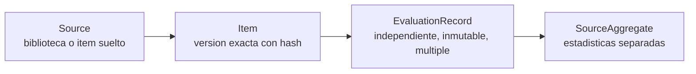

# ICAP

Instrumento de evaluación de calidad pictográfica para comunicación aumentativa y alternativa. Iniciativa de la red MediaFranca.

Regla conceptual del sistema: **PICTOS.net publica bibliotecas; ICAP produce registros de evidencia sobre versiones exactas de sus pictogramas.**

## Fuente de verdad

`spec/icap.allium` es la especificación formal del comportamiento. Ante cualquier duda sobre qué debe hacer el sistema, esa es la respuesta, no este archivo ni el código existente. Está escrita en Allium v3.

El CLI de Allium no está instalado en todos los entornos. Cuando esté disponible, validar con `allium check spec/icap.allium` antes de dar por buena una modificación de la spec.

Documentación de apoyo en `docs/`:

- `ICAP_v2_especificacion.md`, especificación conceptual original
- `ICAP_v2_dimensiones.md`, las 14 dimensiones con paradigmas y referencias
- `ICAP_v2_arquitectura_datos.md`, los cuatro objetos y por qué
- `ICAP_v2_respuesta_evaluacion.md`, respuesta a la evaluación psicométrica externa
- `ICAP_v2_front_requisitos.md`, pantallas y patrones de interacción
- `ICAP_v2_plan_implementacion.md`, fases de construcción

## Ramas

- `main`, versión 1 publicada en GitHub Pages. No tocar sin decisión explícita.
- `v1-archive`, congelado de v1. Inmutable.
- `v2`, frente de trabajo. Reemplazará a `main` cuando esté estable.

## Arquitectura

Cuatro objetos desacoplados. La evaluación no es una propiedad del pictograma.

Catorce dimensiones en cuatro capas, separadas por **origen del dato**, no por objeto de medición:

- Capa A, geométrica: A1 grosor, A2 unidades desligadas, A3 regiones cerradas, A4 contorno inferido. Automática.
- Capa B, psicofísica: B1 desenfoque, B2 tamaño, B3 desplazamiento. Humana, sobre submuestra del 20 por ciento.
- Capa C, interpretativa: C1 semántica, C2 pragmática, C3 cultural, C4 aprendibilidad. Humana, Likert 1 a 5.
- Capa D, familia: D1 confusabilidad, D2 consistencia, D3 fragilidad. Automática.

Veredicto en dos niveles. Vetos duros, que son condiciones necesarias no compensables: A1 y D1 pertenecen a la versión del ítem porque son deterministas, B2 pertenece al registro porque depende del contexto de presentación declarado. Todo lo demás es perfil compensatorio que se reporta pero no elimina.

## Decisiones no negociables

Estas se violaron en v1 o se propusieron y se rechazaron con argumento. Romperlas convierte al instrumento en otra cosa.

1. **Nunca un puntaje único.** No promediar entre capas: sus unidades no son conmensurables. No reconstruir el promedio de v1 por ninguna vía.
2. **Nunca un radar de más de tres ejes.** El hexágono de v1 desapareció por eso. La capa C admite triángulo porque sus tres ejes sí son comparables.
3. **Los vetos son pisos físicos, no predictores estadísticos.** Su justificación no depende de ninguna correlación local, y por eso sobreviven a la recalibración del corpus.
4. **Todo bloqueo muestra su causa.** Nunca un rojo agregado sin veto nombrado.
5. **La ausencia de dato es un dato.** Cuatro estados por dimensión: puntuado, no aplicable, sin competencia para juzgar, omitido. Sin valor por defecto. Forzar un 3 contamina más que aceptar la ausencia.
6. **Nada se corrige en silencio.** El informe de validación de ingesta es bloqueante y descargable, y nombra toda exclusión.
7. **Rúbrica, protocolo y conjunto de calibración viajan en el registro**, no en la aplicación. Un registro sin las tres versiones no es comparable con ningún otro.
8. **Los registros sellados son inmutables.** Ninguna regla de escritura admite `sealed` en su precondición.
9. **La revelación diferida es estructural.** Ni la frase objetivo durante la comprensión espontánea, ni el ancla durante la calibración, pueden llegar al cliente. Ocultarlas con CSS no cumple la garantía.
10. **A3 y A4 son advertencia e hipótesis**, nunca puntajes validados. La distinción debe ser visible en la interfaz.
11. **La divergencia de calibración nunca bloquea.** Los vetos son sobre el signo, no sobre quien juzga.
12. **No automatizar C1 a C4.** Requieren juicio humano y competencia cultural.

## Estado de la evidencia

Toda cifra empírica local está en suspenso. El análisis de referencia corrió sobre 13 pictogramas cuando el corpus es de 21, de modo que correlaciones, intervalos, tasas de cumplimiento y umbrales deben recomputarse antes de tratarse como evidencia. Los valores del bloque `config` de la spec son marcadores de posición heredados de las anclas verbales de la rúbrica de v1, no constantes calibradas.

La arquitectura no depende de esos datos, depende de literatura externa citable. Esa asimetría ya se puso a prueba: al caerse las cifras locales, las decisiones sostenidas en literatura siguieron en pie y las que se apoyaban en el corpus propio quedaron aplazadas.

## Front-end

Stack decidido: framework con build. Nota de despliegue: `main` hoy publica el directorio raíz tal cual en GitHub Pages, de modo que introducir un paso de build exige ajustar la publicación.

Acceso al sitio: abierto, con perfil etnográfico del evaluador, consentimiento versionado y calibración previa bloqueante.

Marca principal: **ICAP**, sola. El nombre extendido va como subtítulo. Hay una inconsistencia heredada por resolver: `index.html` expande la sigla como *Índice de Calidad Pictográfica* y `ICAP-extract/README.md` como *Image-Communication Accessibility Protocol*. La segunda describe mejor lo que el instrumento hace tras la v2, porque ya no produce un índice.

Las surfaces de `spec/icap.allium` mapean casi uno a uno a tipos de pantalla, y sus garantías son requisitos de interfaz, no recomendaciones.

## Convenciones del proyecto

Al escribir archivos `.md`: sin emojis, sin separadores de guiones, notas aclaratorias al pie, y esquemas mermaid en lugar de diagramas ASCII.

Al escribir código: comentarios didácticos al inicio de las funciones, explicando dónde se utilizan.

La documentación del proyecto está en español.
