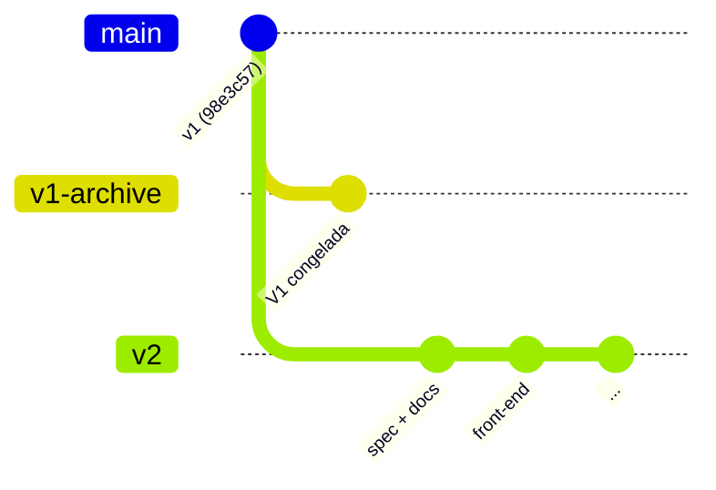
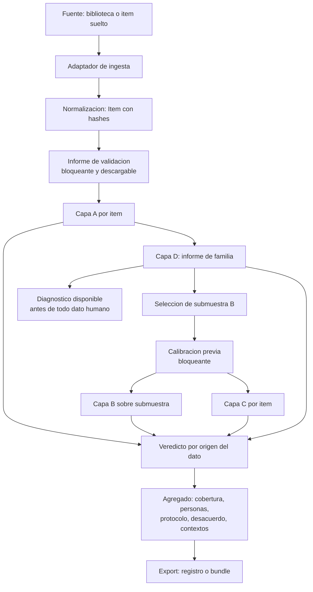

# ICAP v2: plan de implementación

Repositorio `mediafranca/ICAP`, rama `v2`. Documento operativo que acompaña a la especificación formal (`spec/icap.allium`) y a los documentos de diseño de `docs/`.

Este plan define la estrategia de ramas, el flujo operativo y la secuencia de fases de construcción. Fue reordenado tras la evaluación arquitectónica: la versión anterior ordenaba las fases por capa de medición, y ese orden dejó de servir cuando la ingesta y el modelo de registros pasaron a ser prerrequisito de todo lo demás[^1].

## 1. Estrategia de ramas

V1 es un instrumento cerrado y publicable. No se toca. Se preserva como línea de archivo para que cualquier evaluación existente siga siendo reproducible.

La rama `v1-archive` apunta al mismo commit que `main`. El desarrollo ocurre en `v2` y, cuando el instrumento nuevo esté estable, reemplaza a `main`. Mientras tanto `main` sigue sirviendo v1 en GitHub Pages sin interrupción.

Ninguna de las tres ramas depende de otra en tiempo de ejecución: `v1-archive` es inmutable, `main` es la versión publicada del momento, `v2` es el frente de trabajo.

## 2. Flujo operativo

El input no cambia: bibliotecas JSON exportadas de PICTOS.net. Lo que cambia es que la ingesta ahora normaliza, valida y versiona antes de que nadie evalúe nada.

El punto clave sigue siendo que la carga dispara todo el tramo automático en cadena, de modo que el evaluador recibe el informe de familia antes de entregar un solo dato. Lo nuevo es que entre la carga y la evaluación hay ahora dos compuertas: el informe de validación, que impide empezar sobre datos que no se entendieron, y la calibración, que alinea el uso de la escala antes de que la persona puntúe.

## 3. Fases de construcción

El orden antepone lo que es prerrequisito de todo lo demás y deja para el final lo que necesita datos reales sobre los cuales operar.

### Fase 1: Ingesta normalizada

Adaptadores por tipo de fuente, modelo interno estable, resolución de herencia entre fuente e ítem, cálculo de hashes de imagen y enunciado, e informe de validación bloqueante y descargable. Corresponde a `Source`, `Item`, `ImportReport`, `ValidationFinding`, las reglas `ImportSource` y `PublishImportReport`, y la especificación diferida `SourceValidation.normalize`.

Es primero porque sin identidad de versión ninguna evaluación es anclable, y porque la regla de nunca corregir en silencio se implementa aquí o no se implementa.

Criterio de término: importar una biblioteca de PICTOS.net y un pictograma suelto por el mismo camino, con informe descargable que nombre toda exclusión.

### Fase 2: Registro de evaluación

Ciclo de vida del registro con sellado irreversible, doble momento de comprensión con sus transiciones, respuestas dimensionales con estados tipados de ausencia, notas tipadas con visibilidad, sesión con contexto heredable, y calibración previa. Corresponde a `EvaluationSession`, `EvaluationRecord`, `ComprehensionMoment`, `DimensionResponse`, `Note`, `SessionCalibration` y sus reglas.

Es segundo porque define la estructura que todas las capas de medición van a llenar. Construir las capas antes obligaría a rehacerlas cuando el registro cambie de forma.

Criterio de término: abrir, completar y sellar un registro sin que ninguna ruta permita reescribir una respuesta sellada.

### Fase 3: Capa A y extracción de máscara

Cálculo geométrico sobre el bitmap. Corresponde al value type `GeometryLayer`, la regla `ComputeGeometry` y la caja negra `compute_geometry`.

Criterio de término: reproducir las métricas del corpus de referencia, ya recomputado sobre los 21 pictogramas.

### Fase 4: Módulo D

Matriz de confusabilidad con su distribución completa y corte crítico derivado, coeficientes de variación, y ranking de fragilidad. Corresponde a `FamilyReport`, `ConfusablePair` y `FamilyAnalysis.compute`.

Es la contribución original de la v2 y el argumento de publicación. Junto con la fase 3 produce resultados publicables sin recoger un solo dato humano nuevo.

Criterio de término: identificar los pares críticos del corpus de referencia y situar la biblioteca en el plano de confusabilidad contra consistencia.

### Fase 5: Veredicto de dos niveles

Vetos duros separados por origen del dato y perfil compensatorio. Corresponde a los derivados de `Item` y `EvaluationRecord` y a las invariantes que los sostienen.

Antes de cerrar esta fase hay que resolver las preguntas abiertas sobre la derivación del corte crítico de D1 y sobre el tratamiento de la capa B en ítems no muestreados.

### Fase 6: Capa B con protocolo completo

Los tres efectos en canvas, doble pasada por histéresis, tarea de nombrado, aleatorización de partida y de orden. Corresponde a `ThresholdMeasurement`, sus reglas y `ThresholdSampling.select`.

Requiere resolver antes el problema de unidades físicas descrito en los requisitos de front-end: los píxeles de canvas no equivalen a tamaño físico, y sin resolverlo el veto B2 se apoya en una unidad ambigua.

### Fase 7: Agregado

Cobertura, distribuciones, desacuerdo entre evaluadores y contextos cubiertos. Corresponde a `SourceAggregate` y `AggregateComputation.recompute`.

Va al final porque necesita registros reales sobre los cuales calcular, y porque la pregunta abierta sobre cómo resumir la capa C entre registros con estados de ausencia mezclados debe resolverse con datos a la vista.

### Fase 8: Exportación en dos niveles

Registro atómico firmable y bundle con vista compacta o resuelta, más el bloque de retrocompatibilidad con v1. Corresponde a `Export` y sus variantes.

## 4. Trabajo posterior: certificación

Fuera del alcance de la v2 y registrado como preguntas abiertas en la especificación: tamaños mínimos de muestra, umbrales de acuerdo interevaluador, firma o URL verificable, y vigencia, revocación y reevaluación del sello.

La infraestructura que necesita ya existe. Sin identidad de versión y sin registros atómicos firmables no hay sello posible, y ambas cosas están en el modelo desde la fase 1.

## 5. Antes de fijar cualquier umbral

Los valores del bloque `config` son propuestas sin calibrar, y el corpus de referencia está en revisión. El paso honesto después de las fases 3 y 4 es recomputar sobre el corpus completo y correr el instrumento sobre dos o tres bibliotecas de estilos gráficos distintos.

Hasta entonces, todo umbral vive en configuración, editable y registrado en el export, y toda métrica marcada como hipótesis se muestra como dato exploratorio y nunca como puntaje validado.

[^1]: La versión anterior de este plan ordenaba: capa A, módulo D, compuerta, capa B, ficha, export. Ese orden suponía que la evaluación era una propiedad del pictograma. Cuando la evaluación pasó a ser un registro independiente anclado a una versión exacta del ítem, la ingesta y el modelo de registros pasaron a ser prerrequisito de todo lo demás, y las capas de medición se desplazaron detrás de ellos.
