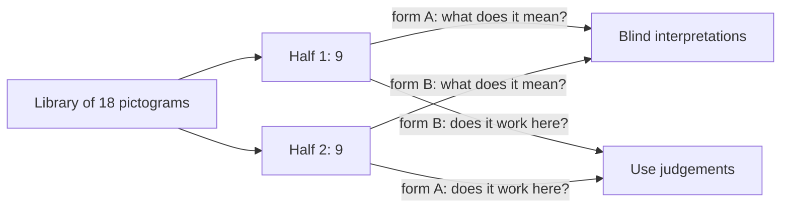
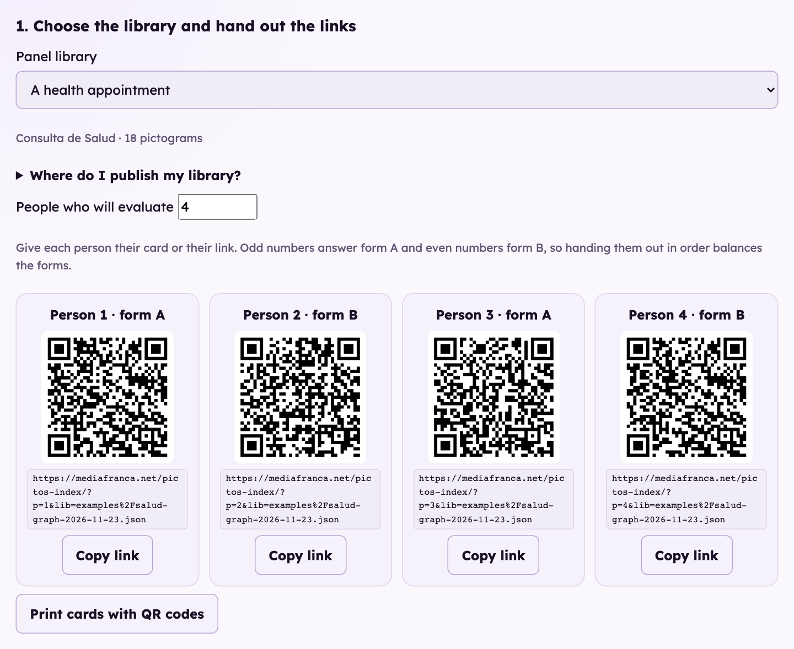
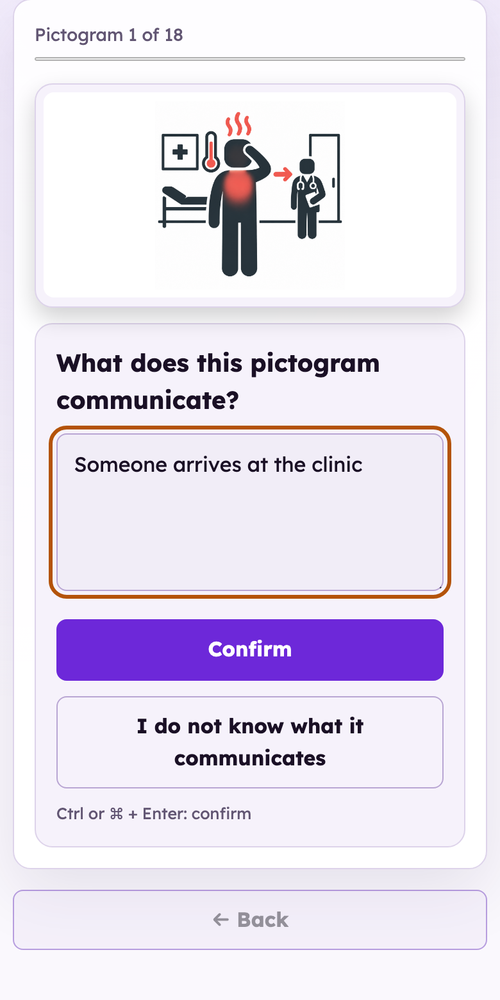
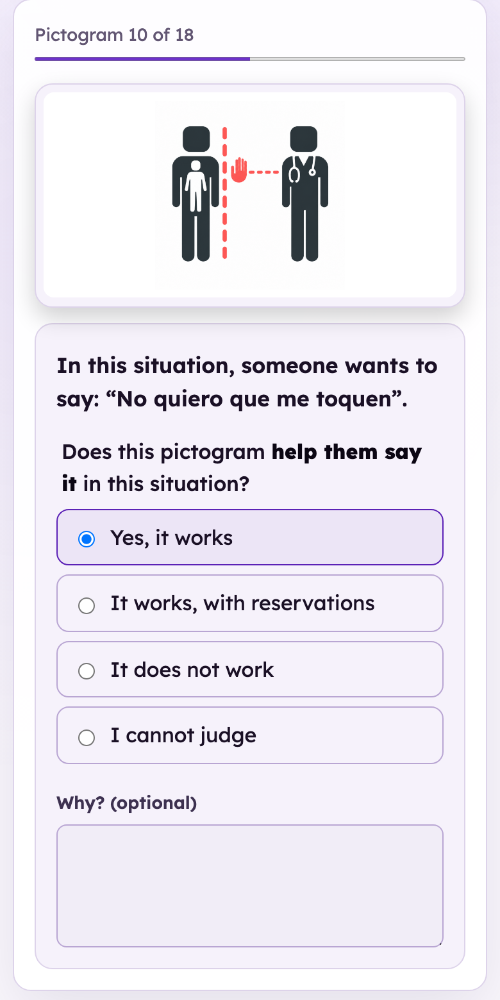
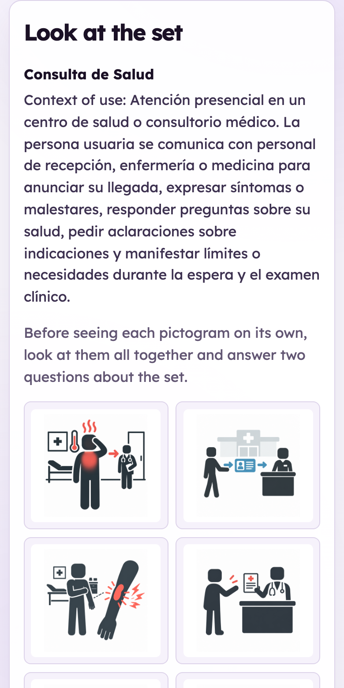

**Castellano:** [protocolo.md](protocolo.md)

# Evaluating with a panel: the form A / form B protocol

This guide explains how to evaluate a pictogram library with a group of people, each on their own phone or computer, and how to turn their answers into results. It is written for the person coordinating a panel; no programming is needed.

> [!NOTE]
> Status: experimental (`protocolo-experimental-0.3`), since PICTOS Index 4.2. There is no server and no database: each person answers in their browser, downloads a file with their answers and sends it to you.

## In short

1. You choose a library and make **one card with a QR code per person** on the [Coordinate a panel](https://mediafranca.net/pictos-index/?coordinar) screen.
2. Each person scans their code and answers. At the end, their phone downloads a file with their answers, which they send to you.
3. You load those files on the same screen. It prepares the sheets for **the judges**, who decide whether each written interpretation got it right.
4. You load the judges' sheets and get the results for each pictogram.

## Why there are two forms, A and B

A "form" is not a character: it is **one of two versions of the questionnaire**. Half the people answer form A and the other half form B.

The protocol wants to know two different things about each pictogram:

- **What does it mean?** Whether someone who does not know the phrase understands what the pictogram is trying to say. This is called *transparency*.
- **Does it work here?** Whether, knowing the phrase, the pictogram works for saying it in a specific situation.

The problem is that nobody can "unknow" a phrase. Once someone has seen that a pictogram means "I am thirsty", they can no longer honestly say what they would have made of it without knowing. So **the same person cannot answer both questions about the same pictogram**.

The solution is to split the library into two halves and hand them out in reverse order:

| Form | Part one: without the phrase | Part two: with the phrase |
|---|---|---|
| **A** | half 1 → "What does it mean?" | half 2 → "Does it work here?" |
| **B** | half 2 → "What does it mean?" | half 1 → "Does it work here?" |

With a library of 18 pictograms, each person interprets 9 blind and judges the other 9 with their phrase. Taken together, **each pictogram gets blind interpretations from half the panel and use judgements from the other half**, and nobody interprets a pictogram whose phrase they have already seen.

**Who gets which form?** Each person's number decides it: odd numbers (1, 3, 5…) answer form A and even numbers (2, 4, 6…) form B. If you hand out the cards in order, the two forms balance by themselves. An even number of people is therefore best; we recommend at least 8.

**How do all the phones know which half is half 1?** The split is computed from the library itself, always the same way. As long as everyone evaluates exactly the same file, every phone gets the same halves, without a server.

## Who takes part

| Role | What they do | How many |
|---|---|---|
| **Coordinator** | Chooses the library, hands out the cards, gathers the files and sheets, and reads the results. | 1 |
| **Evaluators** | Answer the instrument on their phone or computer. | 8 or more, an even number |
| **Judges** | Come in at the end. They compare each written interpretation with the real phrase and decide whether it got it right. They work separately and do not evaluate pictograms. | 2 or more |

Why judges? Interpretations are free text, and someone has to decide whether "I want water" matches "I am thirsty". With two or more independent judges, it is possible to measure whether that decision is reliable.

## Step by step

### 1. Prepare the panel (coordinator)

Open [Coordinate a panel](https://mediafranca.net/pictos-index/?coordinar), also linked from the home page.

1. **Choose the library.** It can be one of the three samples or your own. The library must declare its **context of use** (`config.domainContext`), because the questions are answered with that situation in mind.
2. **If it is your own library, publish it on the internet.** Each person's link carries the library's address, so the file must be readable from another page:
   - **Works:** a GitHub repository (open the file and use the "Raw" button) or a GitHub Gist.
   - **Does not work:** Google Drive, Dropbox or OneDrive, because they show a preview instead of the file.
   - **Do not change the file while the panel runs.** If it changes, the halves change and the evaluations can no longer be compared. On GitHub, use the address of a specific commit.

   When you paste the address, the screen reads it the way the panel's phones will; if something is wrong, you see it there and not in the middle of the evaluation. A library that is only on your computer cannot travel in a link: each person would then have to load the same file by hand.
3. **Say how many people will evaluate.** One card appears per person, with their number, form, QR code, link and a copy button. **"Print cards with QR codes"** prints only the cards, ready to cut out and hand out.

Each link looks like `…/pictos-index/?p=3&lib=…`: `p` is the person's number (and sets their form) and `lib` is the library.

### 2. Evaluate (each person)

Each person scans their code with the phone camera, or opens the link on a computer. The library loads by itself and cannot be changed. Wi-Fi is advisable: a library is several megabytes (the sample ones, about 20 MB).

1. **You.** They read the consent and accept it (they cannot go on without accepting), and state their relationship with Augmentative and Alternative Communication (AAC).
2. **Part one: what does it mean?** For each pictogram in their blind half they write what they think it communicates, or choose "I do not know what it communicates". The phrase is not shown and is not in the page.
3. **Part two: does it work here?** For each pictogram in the other half they see the phrase and answer whether it helps someone say it in that situation: *yes*, *with reservations*, *no* or *I cannot judge*, with an optional reason. Once part two has started, there is no going back to part one.
4. **The set.** At the end they see the whole library as a grid without phrases and rate its formal coherence and visual grammar. It comes last so that part one is answered without the set in view: seeing all the pictograms together offers a contrast that helps guessing.
5. **Submit.** On the last answer, the file with their answers **downloads by itself** and the screen names it. On most phones a "Send the file…" button also appears, which sends it straight to the coordinator by WhatsApp, email or other means.

  
  
  

**The consent** says what is being studied, that no name is asked for, what the file keeps and how to withdraw: simply do not send the file or, if it has been sent, ask the coordinator to delete it. The current text is a draft: before a real panel, replace it with the one the ethics committee approves (keys `consent.*` in `locales/`) and change its version (`CONSENT_VERSION` in `web/app.js`). Each file keeps the accepted version and the time.

If someone closes the browser halfway, opening their link again resumes where they left off.

### 3. Gather the evaluations (coordinator)

In step 2 of the coordination screen, load every file you received. The screen:

- counts the evaluations of each form and warns if they are unbalanced or if a file comes from another library or protocol version (and leaves it out);
- computes the agreement between people on "Does it work here?" (Krippendorff's ordinal alpha; "I cannot judge" counts as missing);
- downloads the **aggregate report** (JSON);
- prepares **one sheet per judge** (`juez-1.csv`, `juez-2.csv`…). Each sheet lists every written interpretation next to its real phrase, in a different random order for each judge and without names, forms or positions. "I do not know" answers are not on the sheets: they count directly as code 6.

### 4. Code (judges)

Each judge opens their sheet in Excel or Google Sheets and, **without seeing what the others do**, writes a number from 1 to 6 in the `codigo` column for each answer:

| Code | Category | Criterion |
|---|---|---|
| 1 | Correct | The answer matches the assigned meaning |
| 2 | Almost correct | The answer is similar or close to the assigned meaning |
| 3 | Doubtful | The answer points to another interpretation or is ambiguous |
| 4 | Incorrect | The answer does not match the assigned meaning |
| 5 | Opposite meaning | The answer points to the contrary meaning |
| 6 | No answer | No answer is given, or the person says they do not know |

This is the six-value scheme of Ramírez (2018, p. 80, Fig. 9), adapted from the comprehension-test procedures described by Brugger (1999), Olgyay, Frascara (2011) and Boersema & Adams (2017). His figure labels it "Brugger–Frascara"; PICTOS Index keeps that label only as an internal name, not as a scale published or validated jointly by Brugger and Frascara.

They then save the sheet as CSV, with the same name, and send it back. The coordination screen includes these instructions, ready to forward.

### 5. Read the results (coordinator)

In step 3, load every returned sheet. The screen shows:

- the problems in each sheet (missing or invalid codes);
- **the agreement between judges** (Krippendorff's nominal alpha), and also on the comprehension rule: strict (code 1 against the rest) and lenient (codes 1 and 2 against the rest);
- the **disagreements to resolve**: answers the judges coded differently. They count as "unresolved" until the judges agree and correct their sheets.

And it downloads:

- **results per item** (CSV), one row per pictogram: its half, how many interpretations it had, how many received each code, the unresolved ones, the settled ones, the strict and lenient comprehension rates with their 95 % confidence intervals, and how often each "Does it work here?" option was chosen;
- the **coding report** (JSON) with all of the above.

#### What counts as "understood"

This rule is fixed here, before any panel, so it cannot be chosen after seeing the data. For each pictogram, the share of settled answers that got it right is computed ("I do not know" counts as code 6; unresolved answers are left out until settled):

- **Strict (primary result):** code 1 only.
- **Lenient (secondary):** codes 1 and 2.

Report the strict rate as the result and the lenient one beside it, each **with its confidence interval** (Wilson, 1927). With few answers the interval is wide: with 10 answers, 70 % runs from 40 % to 89 %. Without the interval, the number suggests a precision the data do not have. The rates allow comparison with the acceptance criterion of ISO 9186-1 or with published comprehension indices.

#### Which alpha to report

The alpha of the **first complete round** of sheets measures how reliable the coding is. If the judges later settle disagreements and resend their sheets, the new alpha measures how far they converged, not how reliable their judgement was. The screen therefore stores the first-round alpha for each panel and never overwrites it; each later set of sheets counts as a new round. **Report the first-round alpha.** It is kept in the coordinator's browser: keep the coding report from that first load.

Codes are categories, not a scale: 6 is not "worse" than 5. Agreement is therefore reported with nominal alpha, and each pictogram with the distribution of its codes, not an average.

Also report the alpha **on the rule**. Two judges can disagree between 3 and 4 without changing any comprehension rate; the alpha behind the reported result is the one on the strict rule (and the lenient one for the secondary result).

## What the app guarantees

- **The same halves on every phone.** The split derives from the library, not from the session.
- **A different order for each person** within each part, with a seed that is recorded.
- **Blind phrases are not in the page.** During part one the phrase does not exist in the document (hiding it with styles would not be enough), and it is not in the exported file either. It is in the library file the browser downloads: someone who knows the developer tools could find it. For a panel of people answering in good faith this is a minor risk, and it is declared.
- **No going back** from part two to part one; after a reload, or when reopening the pictograms, it resumes in part two.
- **Every answer carries its time** (from the moment the pictogram is on screen to the confirmation of the answer) and **the size it was shown at**. The pictogram is shown at a fixed size: 288 px high on wide screens and 160 px on phones. An answer resumed after reloading the page has no time.
- **Every file is traceable:** it carries the person's number, form, the accepted consent, the protocol version, the instrument version and a **library fingerprint** (SHA-256 of every id, phrase and image). Coordination leaves out evaluations whose fingerprint does not match: two libraries with the same ids but other images are no longer confused.

## What it cannot claim

- Each person judges only half the library: there is no complete individual profile.
- "Does it work here?" is the evaluator's judgement on behalf of whoever would use the pictogram, not that person's actual use.
- Transparency cannot be reported until at least two judges have coded the interpretations.
- A carry-over remains and must be declared: the pictograms in part one teach the visual grammar used in part two. That affects the use judgement (*translucency*), not transparency.
- Form (whether the pictogram "looks right") is not asked in the protocol: it is meant to be measured separately and automatically.

## Outside the protocol

Without a participant number (`?p=`) or form (`?forma=`), the app offers the **individual evaluation**: one person interprets each pictogram, then rates it on the six dimensions of the [rubric](rubric.md), and can download a PDF report. That route does not separate transparency from usefulness as the panel does.

## Details for whoever analyses the data

- **Each person's file** (`pictos-index-library-evaluation-1.6.0`): `protocol` (version, form, participant number, seeds, both halves and the full sequence), `evaluator.consent` (`version`, `acceptedAt`), `library.contentHash`, `presentation` (`devicePixelRatio`, `viewport`), `items[].pass` (`blind` or `sighted`), `items[].timing` (`guess` or `use`: `ms` and `imagePx`), `items[].sirve_aqui` (`respuesta`: `yes`, `partly`, `no`, `cannot_judge`; and `motivo`), `libraryAssessment` (coherence and grammar) and `instrumentVersion`.
- **Aggregate report** (`pictos-index-protocol-aggregate-0.3`): per item, the blind interpretations with form and position, and the "Does it work here?" answers with their distribution; plus the list of evaluations with their participant, the library fingerprint (`libraryHash`) and the ordinal alpha.
- **Coding report** (`pictos-index-coding-0.3`): judges, `agreement` (`alpha_nominal`, `alpha_strict`, `alpha_lenient` and `firstRound`), `round`, disagreements and, per item, distribution, unresolved and `comprehension` (`strict`, `lenient`, `settled` and their intervals `strict_ci95`, `lenient_ci95`).
- **Changes since protocol version 0.2:** the set is rated at the end; consent, times, presentation size and the fingerprint are added. Coordination does not mix evaluations from different protocol versions.
- The same can be done from the command line (see [development](development.md)).

## What each aspect rests on

| Aspect | What the protocol does | Grounding |
|---|---|---|
| Transparency ("What does it mean?") | Free interpretation, without the phrase | Transparency as distinct from translucency: Fuller & Lloyd (1991). Comprehension testing with open answers: ISO 9186-1. Transparency norms for 1,525 ARASAAC pictograms, the natural point of comparison: Díez et al. (2024) |
| Use with the phrase ("Does it work here?") | A judgement of use in a situation, with the phrase in view | What is asked once the meaning is known is translucency (Fuller & Lloyd, 1991). Communicative competence depends on the person, partner, task and context (Light, 1989; Light & McNaughton, 2014). "Does it work here?" is PICTOS Index's own wording, not a published scale |
| Forms A and B | Each pictogram blind for half the panel and with its phrase for the other half | Own design, motivated by the transparency–translucency distinction: someone who already knows the meaning cannot give a blind judgement |
| Coding the interpretations | Six codes, from "correct" to "no answer" | Ramírez (2018), adapting comprehension-test procedures for graphic symbols |
| Agreement between judges and between people | Krippendorff's nominal (codes) and ordinal ("Does it work here?") alpha; fixed first round | Krippendorff (2004, 2011) |
| Comprehension rule and intervals | Strict and lenient, fixed before the data, with a Wilson interval | Wilson (1927); acceptance criteria in ISO 9186-1 |
| Relationship with AAC | Recorded to stratify, never averaged | Symbol perception varies with culture, language and the respondent's profile (Huer, 2000; Haupt & Alant, 2002; Dada, Huguet & Bornman, 2013; Kang, Kim & Yeon, 2019) |
| Formal coherence and visual grammar of the set | Two ratings from 1 to 5, at the end | The design tradition of sign systems; no validated measure has been identified, and this is stated |
| What the protocol does not measure | Learnability and effectiveness in a real conversation | They require repeated exposures or a task with a partner (Mizuko, 1987; Alant et al., 2013; Light & McNaughton, 2014): separate studies |

Each construct and its limits are detailed in [foundations.md](foundations.md).

## References

Verified by DOI in OpenAlex. ISO standards are given by title for orientation; their edition has not been checked.

Alant, E., Zheng, W., Harty, M., & Lloyd, L. L. (2013). Translucency ratings of Blissymbols over repeated exposures by children with autism. *Augmentative and Alternative Communication*, 29(3), 272–283. https://doi.org/10.3109/07434618.2013.813967

Dada, S., Huguet, A., & Bornman, J. (2013). The iconicity of picture communication symbols for children with English additional language and mild intellectual disability. *Augmentative and Alternative Communication*, 29(4), 360–373. https://doi.org/10.3109/07434618.2013.849753

Díez, E., Díez-Álamo, A. M., Alonso, M. Á., Wojcik, D. Z., & Fernández, Á. (2024). Transparency and translucency indices for 1,525 pictograms from the Aragonese Portal of Augmentative and Alternative Communication. *Frontiers in Psychology*, 15, 1467796. https://doi.org/10.3389/fpsyg.2024.1467796

Fuller, D. R., & Lloyd, L. L. (1991). Toward a common usage of iconicity terminology. *Augmentative and Alternative Communication*, 7(3), 215–220. https://doi.org/10.1080/07434619112331275913

Haupt, L., & Alant, E. (2002). The iconicity of picture communication symbols for rural Zulu children. *South African Journal of Communication Disorders*, 49(1), 40–49. https://doi.org/10.4102/sajcd.v49i1.216

Huer, M. B. (2000). Examining perceptions of graphic symbols across cultures: Preliminary study of the impact of culture/ethnicity. *Augmentative and Alternative Communication*, 16(3), 180–185. https://doi.org/10.1080/07434610012331279034

ISO 9186-1. Graphical symbols — Test methods — Part 1: Method for testing comprehensibility.

Kang, R., Kim, Y. T., & Yeon, S. J. (2019). Cultural differences on the recognition of social word AAC graphic symbols between Korean and American undergraduate students. *Communication Sciences & Disorders*, 24(1), 71–86. https://doi.org/10.12963/csd.18542

Krippendorff, K. (2004). Reliability in content analysis: Some common misconceptions and recommendations. *Human Communication Research*, 30(3), 411–433. https://doi.org/10.1111/j.1468-2958.2004.tb00738.x

Krippendorff, K. (2011). *Computing Krippendorff's alpha-reliability*. Annenberg School for Communication, University of Pennsylvania. https://repository.upenn.edu/asc_papers/43

Light, J. (1989). Toward a definition of communicative competence for individuals using augmentative and alternative communication systems. *Augmentative and Alternative Communication*, 5(2), 137–144. https://doi.org/10.1080/07434618912331275126

Light, J., & McNaughton, D. (2014). Communicative competence for individuals who require augmentative and alternative communication: A new definition for a new era of communication? *Augmentative and Alternative Communication*, 30(1), 1–18. https://doi.org/10.3109/07434618.2014.885080

Mizuko, M. (1987). Transparency and ease of learning of symbols represented by Blissymbols, PCS, and Picsyms. *Augmentative and Alternative Communication*, 3(3), 129–136. https://doi.org/10.1080/07434618712331274409

Ramírez M., R. (2018). El desempeño de íconos como herramienta gráfica para comunicar la emergencia. *Revista de Estudios Latinoamericanos sobre Reducción del Riesgo de Desastres REDER*, 2(1), 71–87. https://doi.org/10.55467/reder.v2i1.12

Wilson, E. B. (1927). Probable inference, the law of succession, and statistical inference. *Journal of the American Statistical Association*, 22(158), 209–212. https://doi.org/10.1080/01621459.1927.10502953
