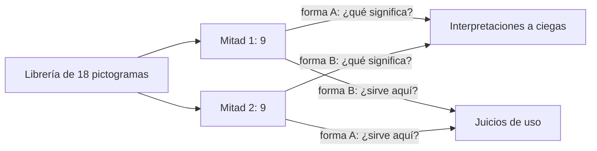
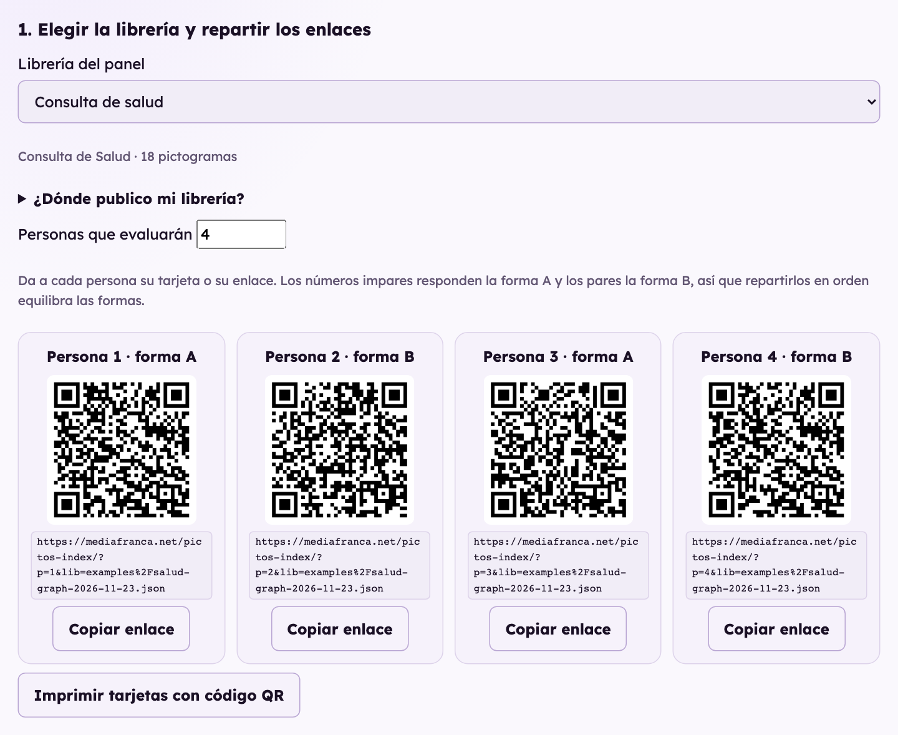
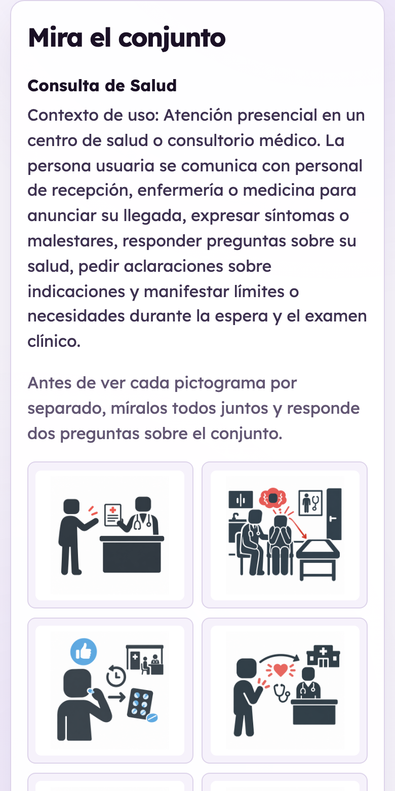
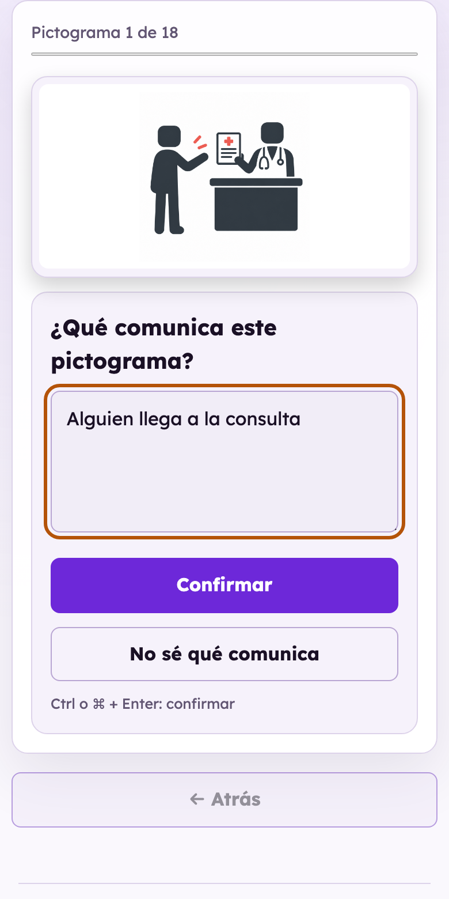
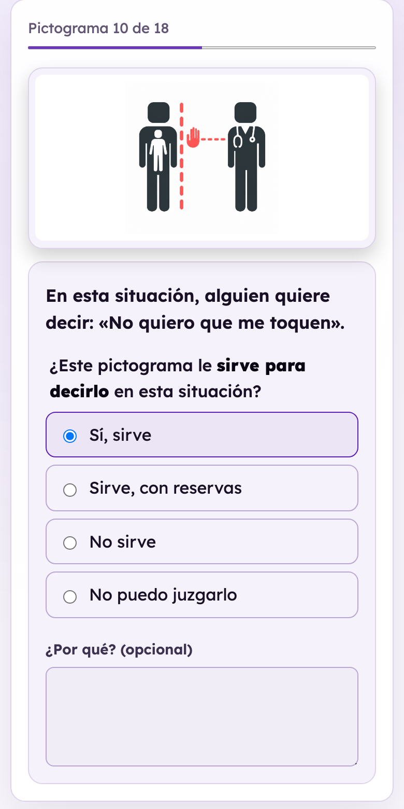

**English:** [protocol.md](protocol.md)

# Evaluar en panel: el protocolo de formas A y B

Esta guía explica cómo evaluar una librería de pictogramas con un grupo de personas, cada una desde su teléfono o computador, y cómo convertir sus respuestas en resultados. Está pensada para quien coordina un panel; no hace falta saber programar.

> [!NOTE]
> Estado: experimental (`protocolo-experimental-0.2`), en PICTOS Index 4.x. No hay servidor ni base de datos: cada persona responde en su navegador, descarga un archivo con sus respuestas y te lo envía.

## En breve

1. Eliges una librería y generas **una tarjeta con código QR para cada persona** en la pantalla [Coordinar un panel](https://mediafranca.net/pictos-index/?coordinar).
2. Cada persona escanea su código y responde. Al terminar, su teléfono descarga un archivo con sus respuestas, que te envía.
3. Cargas esos archivos en la misma pantalla. Allí se preparan las planillas para **los jueces**, que deciden si cada interpretación escrita acertó.
4. Cargas las planillas de los jueces y obtienes los resultados de cada pictograma.

## Por qué hay dos formas, A y B

Una «forma» no es un personaje: es **una de las dos versiones del cuestionario**. La mitad de las personas responde la forma A y la otra mitad, la forma B.

El protocolo quiere saber dos cosas distintas de cada pictograma:

- **¿Qué significa?** Si alguien que no conoce la frase entiende lo que el pictograma quiere decir. Esto se llama *transparencia*.
- **¿Sirve aquí?** Si, conociendo la frase, el pictograma sirve para decirla en una situación concreta.

El problema es que nadie puede «dejar de saber» una frase. Si alguien ve primero que un pictograma quiere decir «tengo sed», ya no puede contestar honestamente qué le habría parecido sin saberlo. Por eso **una misma persona no puede responder las dos preguntas sobre el mismo pictograma**.

La solución es dividir la librería en dos mitades y repartirlas en orden inverso:

| Forma | Primera parte: sin la frase | Segunda parte: con la frase |
|---|---|---|
| **A** | mitad 1 → «¿Qué significa?» | mitad 2 → «¿Sirve aquí?» |
| **B** | mitad 2 → «¿Qué significa?» | mitad 1 → «¿Sirve aquí?» |

Con una librería de 18 pictogramas, cada persona interpreta 9 a ciegas y juzga los otros 9 con su frase. Al juntar a todas, **cada pictograma recibe interpretaciones a ciegas de la mitad del panel y juicios de uso de la otra mitad**, y nadie interpreta un pictograma cuya frase ya vio.

**¿Quién recibe qué forma?** La decide el número de cada persona: los impares (1, 3, 5…) responden la forma A y los pares (2, 4, 6…), la B. Si repartes las tarjetas en orden, las dos formas quedan equilibradas solas. Por eso conviene un número par de personas; recomendamos al menos 8.

**¿Cómo saben todos los teléfonos cuál es la mitad 1?** La división se calcula a partir de la propia librería, siempre igual. Mientras todos evalúen exactamente el mismo archivo, todos los teléfonos obtienen las mismas mitades, sin necesidad de un servidor.

## Quiénes participan

| Rol | Qué hace | Cuántas personas |
|---|---|---|
| **Coordinación** | Elige la librería, reparte las tarjetas, reúne los archivos y las planillas, y lee los resultados. | 1 |
| **Personas evaluadoras** | Responden el instrumento desde su teléfono o computador. | 8 o más, en número par |
| **Jueces** | Llegan al final. Comparan cada interpretación escrita con la frase real y deciden si acertó. Trabajan por separado y no evalúan pictogramas. | 2 o más |

¿Por qué jueces? Las interpretaciones son texto libre, y alguien tiene que decidir si «quiero agua» acierta con «tengo sed». Con dos o más jueces independientes se puede medir si esa decisión es fiable.

## Paso a paso

### 1. Preparar el panel (coordinación)

Abre [Coordinar un panel](https://mediafranca.net/pictos-index/?coordinar), también enlazado desde la portada.

1. **Elige la librería.** Puede ser una de las tres de ejemplo o una propia. La librería debe declarar su **contexto de uso** (`config.domainContext`), porque las preguntas se responden pensando en esa situación.
2. **Si es una librería propia, publícala en internet.** El enlace de cada persona lleva consigo la dirección de la librería, así que el archivo tiene que poder leerse desde otra página:
   - **Funciona:** un repositorio de GitHub (abre el archivo y usa el botón «Raw»), un Gist de GitHub o un sitio en Netlify.
   - **No funciona:** Google Drive, Dropbox ni OneDrive, porque muestran una vista previa en vez del archivo.
   - **No cambies el archivo mientras dure el panel.** Si cambia, las mitades cambian y las evaluaciones dejan de ser comparables. En GitHub, usa la dirección de un commit concreto.

   Al pegar la dirección, la pantalla la lee igual que lo harán los teléfonos del panel; si algo falla, lo verás ahí y no en medio de la evaluación. Una librería que solo está en tu computador no puede viajar en un enlace: en ese caso cada persona tendría que cargar el mismo archivo a mano.
3. **Indica cuántas personas evaluarán.** Aparece una tarjeta por persona, con su número, su forma, su código QR, su enlace y un botón para copiarlo. **«Imprimir tarjetas con código QR»** imprime solo las tarjetas, listas para recortar y entregar.

Cada enlace tiene la forma `…/pictos-index/?p=3&lib=…`: `p` es el número de la persona (y decide su forma) y `lib` es la librería.

### 2. Evaluar (cada persona)

Cada persona escanea su código con la cámara del teléfono, o abre el enlace en un computador. La librería se carga sola y no se puede cambiar. Conviene usar wifi: una librería pesa varios megabytes (las de ejemplo, unos 20 MB).

1. **Tú.** Declara su relación con la Comunicación Aumentativa y Alternativa (CAA).
2. **Conjunto.** Ve la librería completa, como grilla y sin frases, y valora su coherencia formal y su gramática visual. Ver el conjunto no revela ninguna frase.
3. **Primera parte: ¿qué significa?** Para cada pictograma de su mitad a ciegas escribe qué cree que comunica, o marca «No sé qué comunica». La frase no se muestra ni está en la página.
4. **Segunda parte: ¿sirve aquí?** Para cada pictograma de la otra mitad ve la frase y responde si le sirve a alguien para decirla en esa situación: *sí*, *con reservas*, *no* o *no puedo juzgarlo*, con un motivo opcional. Una vez empezada la segunda parte no se puede volver a la primera.
5. **Entrega.** Al responder la última pregunta, el archivo con sus respuestas **se descarga solo** y la pantalla dice su nombre. En la mayoría de los teléfonos aparece además «Enviar el archivo…», que lo manda directamente por WhatsApp, correo u otro medio a quien coordina.

  
  
  

Si una persona cierra el navegador a mitad de camino, al volver a abrir su enlace continúa donde quedó.

### 3. Reunir las evaluaciones (coordinación)

En el paso 2 de la pantalla de coordinación, carga todos los archivos que te enviaron. La pantalla:

- cuenta cuántas evaluaciones hay de cada forma y avisa si están desequilibradas o si algún archivo es de otra librería o de otra versión del protocolo (y lo deja fuera);
- calcula el acuerdo entre personas en «¿Sirve aquí?» (alfa de Krippendorff ordinal; «no puedo juzgarlo» cuenta como dato faltante);
- descarga el **informe agregado** (JSON);
- prepara **una planilla para cada juez** (`juez-1.csv`, `juez-2.csv`…). Cada planilla trae todas las interpretaciones escritas junto a su frase real, en un orden aleatorio distinto para cada juez y sin nombres, formas ni posiciones. Las respuestas «No sé» no van a las planillas: cuentan directamente como código 6.

### 4. Codificar (jueces)

Cada juez abre su planilla en Excel o Google Sheets y, **sin ver lo que hacen los demás**, escribe en la columna `codigo` un número del 1 al 6 para cada respuesta:

| Código | Categoría | Criterio |
|---|---|---|
| 1 | Correcto | La respuesta coincide con el significado asignado |
| 2 | Casi correcto | La respuesta es parecida o cercana al significado |
| 3 | Dudoso | La respuesta apunta a otra interpretación o es ambigua |
| 4 | Incorrecto | La respuesta no corresponde al significado |
| 5 | Significado opuesto | La respuesta apunta al significado contrario |
| 6 | Sin respuesta | No responde o dice que no sabe |

Es el esquema de seis valores de Ramírez (2018, p. 80, fig. 9), que él adaptó de los procedimientos de prueba de comprensión descritos por Brugger (1999), Olgyay, Frascara (2011) y Boersema y Adams (2017). Su figura lo rotula «Brugger–Frascara»; PICTOS Index conserva ese rótulo solo como nombre interno, no como una escala publicada o validada en conjunto por Brugger y Frascara. Redacción sugerida para publicaciones: «Se aplicó el esquema de codificación de seis valores de Ramírez (2018, p. 80), referido internamente como "Brugger–Frascara"».

Luego guarda la planilla como CSV, con el mismo nombre, y la devuelve. La pantalla de coordinación incluye estas instrucciones listas para reenviar.

### 5. Leer los resultados (coordinación)

En el paso 3, carga todas las planillas devueltas. La pantalla muestra:

- los problemas de cada planilla (códigos que faltan o no son válidos);
- **el acuerdo entre jueces** (alfa de Krippendorff nominal);
- los **desacuerdos por resolver**: respuestas a las que los jueces dieron códigos distintos. Se cuentan como «sin resolver» hasta que los jueces se pongan de acuerdo y corrijan sus planillas.

Y descarga:

- **resultados por ítem** (CSV), una fila por pictograma: su mitad, cuántas interpretaciones tuvo, cuántas recibieron cada código, las sin resolver, la tasa de acierto estricta y laxa, y cuántas veces se respondió cada opción de «¿Sirve aquí?»;
- el **informe de codificación** (JSON) con todo lo anterior.

#### Qué cuenta como «entendido»

Esta regla se fija aquí, antes de cualquier panel, para que no se elija después de ver los datos. Para cada pictograma se calcula la proporción de respuestas resueltas que acertaron (las «No sé» cuentan como código 6; las sin resolver quedan fuera hasta resolverse):

- **Estricta (resultado principal):** solo código 1.
- **Laxa (secundaria):** códigos 1 y 2.

Informa la estricta como resultado y la laxa a su lado. Sirven para comparar con el criterio de aceptación de la norma ISO 9186-1 o con índices de comprensión publicados.

#### Qué alfa informar

El alfa de la **primera ronda completa** de planillas mide la fiabilidad de la codificación. Si después los jueces resuelven desacuerdos y reenvían sus planillas, el nuevo alfa mide cuánto convergieron, no cuán fiable era su juicio. Por eso la pantalla guarda el alfa de la primera ronda de cada panel y nunca lo sobrescribe; cada juego posterior de planillas cuenta como una ronda nueva. **Informa el alfa de la primera ronda.** Se guarda en el navegador de quien coordina: conserva el informe de codificación de esa primera carga.

Los códigos son categorías, no una escala: 6 no es «peor» que 5. Por eso el acuerdo se informa con alfa nominal y cada pictograma con la distribución de sus códigos, no con un promedio.

## Qué garantiza la aplicación

- **Las mismas mitades en todos los teléfonos.** La división se deriva de la librería, no de la sesión.
- **Orden distinto para cada persona** dentro de cada parte, con una semilla que queda registrada.
- **Las frases a ciegas no están en la página.** Durante la primera parte la frase no existe en el documento (ocultarla con estilos no bastaría), y tampoco va en el archivo exportado.
- **No se vuelve atrás** de la segunda parte a la primera; tras una recarga se retoma en el primer pictograma sin terminar.
- **Cada archivo es trazable:** lleva el número de la persona, su forma, la versión del protocolo y la versión del instrumento.

## Qué no puede afirmar

- Cada persona juzga solo la mitad de la librería: no hay un perfil individual completo.
- «¿Sirve aquí?» es un juicio de la persona evaluadora en nombre de quien usaría el pictograma, no el uso real de esa persona.
- La transparencia no se puede informar hasta que al menos dos jueces hayan codificado las interpretaciones.
- Queda un arrastre que hay que declarar: los pictogramas de la primera parte enseñan la gramática visual que se usa en la segunda. Eso afecta el juicio de uso (la *translucidez*), no la transparencia.
- La forma (si el pictograma «se ve bien») no se pregunta en el protocolo: está pensada para medirse aparte, de forma automática.

## Fuera del protocolo

Sin número de participante (`?p=`) ni forma (`?forma=`), la aplicación ofrece la **evaluación individual**: una sola persona interpreta cada pictograma y luego lo califica en las seis dimensiones de la [rúbrica](rubric.md), y puede descargar un informe PDF. Ese recorrido no separa transparencia de utilidad como lo hace el panel.

## Detalles para quien analiza los datos

- **Archivo de cada persona** (`pictos-index-library-evaluation-1.5.0`): `protocol` (versión, forma, número de participante, semillas, las dos mitades y la secuencia completa), `items[].pass` (`blind` o `sighted`), `items[].sirve_aqui` (`respuesta`: `yes`, `partly`, `no`, `cannot_judge`; y `motivo`), `libraryAssessment` (coherencia y gramática) e `instrumentVersion`.
- **Informe agregado** (`pictos-index-protocol-aggregate-0.2`): por ítem, las interpretaciones a ciegas con forma y posición, y las respuestas de «¿Sirve aquí?» con su distribución; además, la lista de evaluaciones con su participante y el alfa ordinal.
- **Informe de codificación** (`pictos-index-coding-0.2`): jueces, `agreement` (alfa nominal y `firstRound`), `round`, desacuerdos y, por ítem, distribución, sin resolver y `comprehension` (`strict`, `lenient`).
- Lo mismo puede hacerse por línea de comandos (ver [desarrollo](desarrollo.md)).

## Referencias

Krippendorff, K. (2011). *Computing Krippendorff's alpha-reliability*. Annenberg School for Communication, University of Pennsylvania. https://repository.upenn.edu/asc_papers/43

Ramírez M., R. (2018). El desempeño de íconos como herramienta gráfica para comunicar la emergencia. *Revista de Estudios Latinoamericanos sobre Reducción del Riesgo de Desastres REDER*, 2(1), 71–87. https://doi.org/10.55467/reder.v2i1.12
